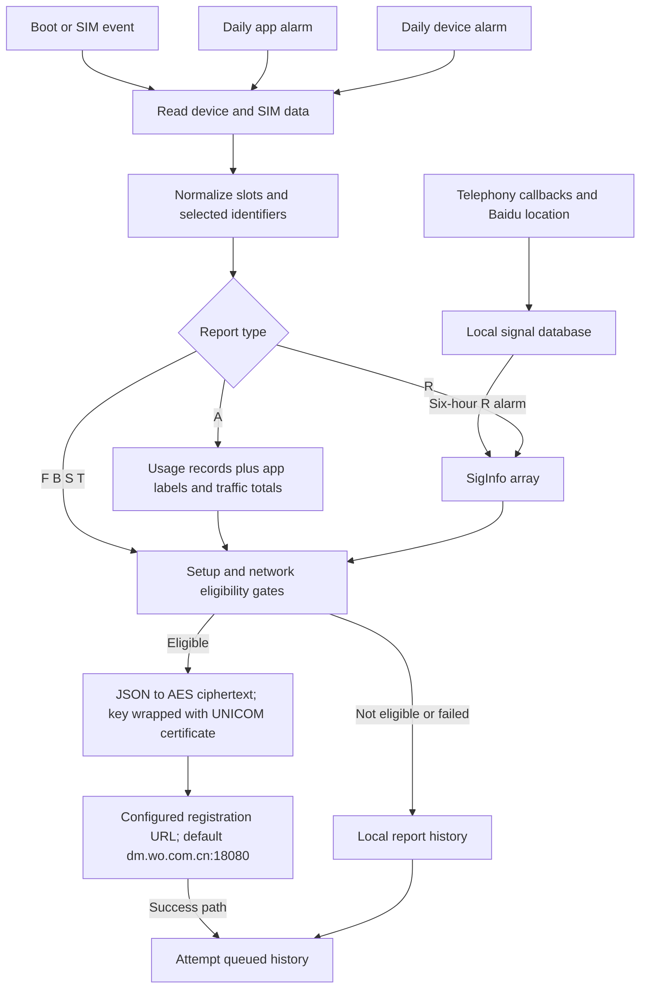

# SystemHelper reporting path — focused follow-up

**Scope:** `com.mobiletools.systemhelper` `3.0.0-20231222` (versionCode 31), copied from this phone's `/system/priv-app/SystemHelper/SystemHelper.apk`. No other component was investigated further. All phone commands remained read-only. [Selected evidence notes](selected-evidence.md) summarize the retained analysis; full instruction-level extracts and raw runtime evidence remain private. [APK hashes](apk_hashes.json) identify the examined files.

**Assessment:** This APK implements **China Unicom-oriented device, app-usage and signal/location reporting**, with an embedded **Baidu location SDK**. The destination, encryption certificate and carrier predicates strongly support the intended carrier recipient. They do **not** prove that a particular report from this phone reached Unicom. The current endpoint override, queued records and transmitted plaintext remain inaccessible without additional access.

## Confirmed reporting implementation

This traces the Java reporting path through its network write. It does not claim that every branch executed on this device or fully reverse engineer Baidu's native implementation.

### Triggers and frequency

| Trigger | Code path / report type | Static behavior | Runtime evidence on this phone |
|---|---|---|---|
| Boot / quick boot | `OnBootReceiver` → type `F` first time, otherwise `B` | Registers telephony callbacks; schedules itself after **4 minutes**, plus subsequent device/app/signal alarms. A local `firstPowerOn` preference selects F/B. | Boot alarm history exists; the private preference could not be read. |
| SIM-state event | `SIMStateReceiver` → `T` | Ready-state processing can wait **6 minutes**. Dispatch compares remembered ICCIDs and returns without posting T if neither SIM changed. | SIM receiver alarm history exists; actual ICCID values were not collected for this follow-up. |
| Device registration alarm | `ScheduleRegisterReceiver` → `S` | Self-reschedules. Default **24 hours**, with **0–9 seconds** of jitter in the fallback; `scheduleInterval` preference overrides it. | 35 retained alarm deliveries; last/next distances are consistent with ~24 hours. |
| App reporting alarm | `AppInfoRegisterReceiver` → `A` | Self-reschedules; `appInfoInterval` defaults to **24 hours**. Collects usage over `now − 24 hours` to `now` using a separate static window constant. | 35 retained deliveries; ~24 hours between the recorded last and planned next alarm. |
| Signal reporting alarm | `SignalInfoRegisterReceiver` → `R` | Self-reschedules; `signalInfoInterval` defaults to **6 hours**. Reads buffered signal records, then clears that signal buffer before sender completion. | 140 retained deliveries; last/next distances are consistent with ~6 hours. |
| Telephony callbacks | `control.a` | Signal changes collect radio state and request location; call-disconnection/data-failure callbacks update sample fields. Timing, permissions, network identity and validity affect samples. | Recent fine-location/Wi-Fi AppOps access and earlier logs entering Baidu code establish some execution; no sample or transmitted payload was obtained. |

The follow-up snapshot had signal, app and device alarms due in approximately **4h05m, 22h04m and 22h07m** respectively. They are exact, one-shot wakeup alarms (`repeatInterval=0`), rearmed by receivers. **Alarm deliveries are not successful uploads.** Counts come from retained history, not continuous observation during this investigation. Signal sampling is event-driven; a uniform sample interval was not established. [S1, S4, S11](selected-evidence.md)

The connectivity receiver in this APK logs connectivity changes; its inspected `onReceive` does **not** directly dispatch a report. `RegisterJobService.onStartJob` likewise does not initiate collection, and no active SystemHelper JobScheduler job was present. This prevents mistaking declared components for effective reporting triggers.

## What enters the payload

These are **serialized fields and their code paths**, not captured values from this phone. Nulls, API failures, empty strings and placeholders can change actual key/value inclusion. No request body was recovered.

| Record | Fields constructed by the code | Important restrictions |
|---|---|---|
| Common device/report envelope | `Manuf`, `Model`, `HWVersion`, `SWVersion`, `OS`, `OSVersion`; `DataSlot`, `AccType`, `SubType`, `DeviceType`; `RegType`, `SpecVersion`, `ClientVersion`, `Time` | `SubType` carries `RAM`, `ROM`, `FREE`. Report specification is `5.0`. Manufacturer selects the Xiaomi adapter; this does not establish a Xiaomi upload destination. |
| Two SIM/radio groups | For each suffix `1`/`2`: `IMEI`, `ICCID`, `IMSI`, `MNC`, `NetworkType`, `TAC`, `CID`, `PCI`, `VolteEnabled`, `5GEnabled`, `VoNREnable` | The “MNC” values can contain combined country/operator codes. The normalizer can reorder the slot groups by IMEI and adjust `DataSlot`. See transformations below. |
| `AppInfo` — type `A` (or empty-type serialization) | `appLabel`, `pkgName`, `Time`, `runTime`, `tx1`, `rx1`, `tx2`, `rx2`, `totalData1`, `totalData2`, `totalDataWiFi` | Starts with **usage records**, joins against installed applications, sorts by foreground time, and excludes package names starting `com.android`. Thus it is not simply a dump of every installed app. Runtime is whole foreground minutes; mobile totals use KB and Wi-Fi totals MB. |
| `SigInfo` — type `R` (or empty-type serialization) | `Time`, `IMEI`, `MSISDN`, `MNC`, `IMSI`, `TAC`, `CID`, `PCI`, `NetworkType`, `ARFCN`, `Bands`, `Bandwidth`, `CQITableIndex`, `CQIIndex`, `RSRP`, `RSRQ`, `SINR`, `CSIRSRP`, `CSIRSRQ`, `CSISINR`, `Uspeed`, `Dspeed`, `CallDisconnectCause`, `DataFailCause`, `EPSFallback`, `LONGITUDE`, `LATITUDE`, `ALTITUDE`, `SPEED`, `BEARING` | Buffered through a local signal table bounded to about 100 records. Key names alone overstate collection: `Uspeed`, `Dspeed`, `EPSFallback` have no non-constructor writer found; the inspected MSISDN path assigns empty/placeholder data, with no first-party phone-number API read found. Location failures also produce placeholders. |
| Optional IP fields | `IPv4`, `IPv6` | A branch can GET `/public/ip` and enumerate IPv6 interfaces. Its controlling static flag `c.d.a.b.e.c` defaults to **false**, with no DEX write to enable it found. Nonempty IP fields therefore are not established on the ordinary traced path. |

[Root construction/normalization: S2; app builder/filter: S3; signal builder: S4; optional IP path: S7–S8](selected-evidence.md)

**Identifier transformations matter:** The root-record normalizer clears both SIM identifier/radio groups when nonempty ICCIDs fail its `89` prefix check or nonempty operator codes fail its `460` prefix check. For retained, non-Unicom SIMs, it SHA-256 hashes **ICCID, IMSI, CID and TAC**; Unicom recognition here uses ICCID prefixes `898601`, `898606`, `898609`. It does **not** hash retained IMEIs in this method. This transformation applies to the **root record**; nested `SigInfo` is built separately, so one must not assume its identifiers receive identical treatment. These branches have not been evaluated against this phone's personal SIM values. [S2, S4](selected-evidence.md)

No image field or capture-to-report path was found in this SystemHelper reporting chain. The concrete records above substantiate telemetry capabilities, not screenshot uploads.

## Sending, storage and destinations

`control.f.run()` checks the setup-derived flag, then validates nonempty IMEIs for 15-digit numeric format and checks connectivity. Its network policy accepts either:

- connected Wi-Fi **and** an operator code starting `460` in either normalized SIM group; or
- the code's non-roaming branch **and** active-data-SIM recognition using Unicom codes `46001/46006/46009` or ICCID prefixes `898601/898606/898609`.

The inherited “roaming” method constructs a fresh `ServiceState` and reads its roaming flag, so it should not be treated as a verified observation of the actual subscription's roaming state. These gates can prevent a report even when its alarm fires. [S6](selected-evidence.md)

For plaintext JSON `P`, the sender derives `K = MD5(UTF8(P))`, encrypts P using `AES/ECB/PKCS5Padding`, wraps K using `RSA/ECB/PKCS1Padding` and APK asset `pub.cer`, and places the Base64/URL-encoded wrapped key in the `sign` query parameter. It POSTs the ciphertext as `application/encrypted-json`, with `ver=5.0`, model and manufacturer query parameters. The helper treats HTTP 200 as success; the caller also accepts status 416. This encryption construction was traced statically, not tested against the service. [S6, S9](selected-evidence.md)

Ineligible/failed reports are saved to local history (`dmregister`, with a separate `typef` table). A successful current report starts history-posting code. Stored JSON is re-encrypted and sent through the same configured destination. History getters remove records as they read them; there is no basis to assume indefinite or reliable delivery. Private databases/preferences could not be inspected.

| Destination | Attribution and evidence | What remains unknown |
|---|---|---|
| `http://dm.wo.com.cn:18080/register` | **Default carrier reporting recipient: China Unicom.** In addition to carrier-specific code, encryption certificate subject/issuer are `CN=UNICOM,OU=UNICOM,O=UNICOM,…`; its key is 1024-bit RSA. | The subject is self-asserted, not authenticated ownership proof. Current destination overrides and actual receipt were not observed. |
| Host-side DNS for `dm.wo.com.cn` | A public DNS answer was observed on the analysis computer. | This was **not a phone connection**; CDN/hosting operator and ultimate processor are not established. The answer is omitted because it is time-dependent and does not establish a device recipient. |
| `http://dm.wo.com.cn:18080/public/ip` | Hardcoded IP-discovery helper on the same carrier host. | Its enabling branch appears dormant as described above. |
| Baidu domains, including `loc.map.baidu.com`, `ofloc.map.baidu.com`, `itsdata.map.baidu.com`, `api.map.baidu.com`, `daup.map.baidu.com`, `parking.baidu.com` | Embedded location/authentication/offline/telemetry SDK code provides a **separate potential recipient: Baidu**. Earlier runtime exceptions show SystemHelper entering Baidu location code. | Static URLs and attempted SDK execution do not prove successful requests to every hostname or the data delivered. Native SDK internals were not fully audited. |

The [complete literal URL inventory](systemhelper_endpoints.md) separates endpoint candidates from compiler/schema metadata and omits query strings. No hardcoded numeric registration address was found in the traced path.

The certificate fingerprint is [recorded separately](systemhelper_encryption_certificate.json). The APK signing certificate is **NewDM**, distinct from Xiaomi's platform signer. Its `RI`/`CU` fields alone do not establish the SDK author's legal identity. No Xiaomi-operated network endpoint was identified in the first-party registration path; Xiaomi appears as a manufacturer adapter here. This does not exclude indirect or unobserved traffic elsewhere in the embedded SDK.

External corroboration: the authors of *Android OS Privacy Under the Loupe* identify `com.mobiletools.systemhelper` as the China Unicom SDK and `dm.wo.com.cn` as a Unicom endpoint, including an asymmetric-encryption reporting path. Their experiments used other firmware/devices; their observed transmissions are **not runtime evidence for this phone**. [Original research, §§6.2 and consent discussion](https://arxiv.org/html/2302.01890v1)

## Consent: checked state versus an informed decision

**Confirmed in code:** the Xiaomi adapter sets `isUserPermissionOpen` from **`Settings.Global.device_provisioned == 1`**. Both initial and follow-up phone queries returned `1`. The sender and app-collection branches use that flag. It represents completion of setup; it is not a separate, purpose-specific consent record. A different manufacturer's adapter checks `dm_user_agreement`, but that adapter is not the Xiaomi-selected path.

**Also confirmed in code:** before starting Baidu location, SystemHelper checks `LocationManager.isLocationEnabled()` and calls `com.baidu.location.h.b(true)`. The latter sets the SDK privacy flag `K`; its paired check explicitly refers to `setAgreePrivacy` and throws when K is false. Thus **SystemHelper asserts SDK privacy agreement programmatically** on this path, rather than reading a separate user's choice there. Android permission checks and the Location switch still affect access. [S4–S5](selected-evidence.md)

No independent privacy opt-in, analytics opt-out, or policy-acceptance UI is consulted in the traced automatic reporting path. This supports a finding of **no meaningful independent consent gate in this path**, not a claim that no disclosure or bundled terms were ever shown during this phone's setup. Setup UI/history was not reconstructed, and no legal conclusion is made.

## Runtime boundary and remaining proof

**Confirmed on this phone:** package identity/privileges, setup flag `1`, running process, recent location/Wi-Fi AppOps access, the alarm/history pattern above, Baidu-related exceptions/socket-tagging in earlier bounded logs, and **890,457 historical transmitted bytes** for UID 10090 (currently only SystemHelper). The follow-up UID-log command returned no entries, and neither readable TCP table had a UID-10090 socket at that moment.

**Not verified:** actual current `serverAddress`/interval preferences; particular app or signal records; successful Baidu location results; any registration request destination/peer; Unicom receipt; precise upload cadence; or screenshots. `RegisterHelperService` has an exported configuration Binder path that can change the endpoint and intervals, without a caller-permission check found in those inspected methods. It was **not invoked**. This is why a hardcoded URL cannot be presented as this phone's confirmed current recipient. [S7, S10–S13](selected-evidence.md)

The next decisive evidence would be locally retained, process-attributed traffic during natural alarm execution, linked to plaintext before encryption or a decrypted request and response. Destination/timing capture alone would strengthen recipient attribution but would not prove the field values. No rooting, interception setup, forced alarm, app launch, setting write, endpoint probe, tool installation or artifact upload was performed. The only external lookup added here was public-hostname DNS and public research; no device identifier or artifact was sent.
